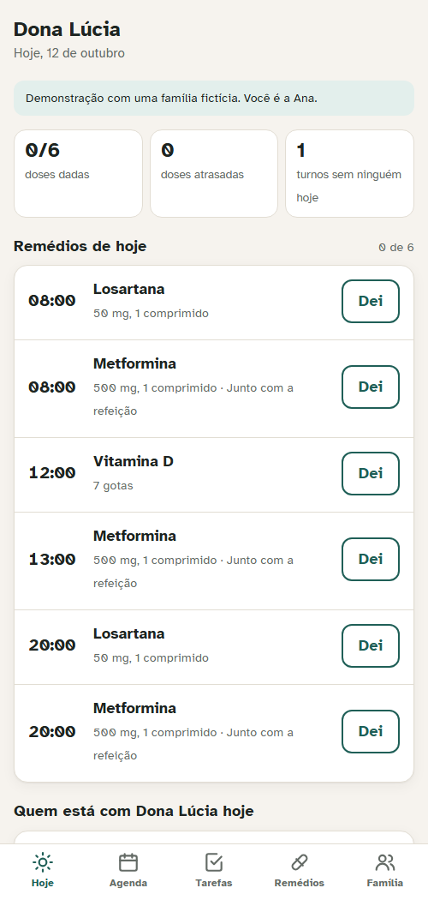
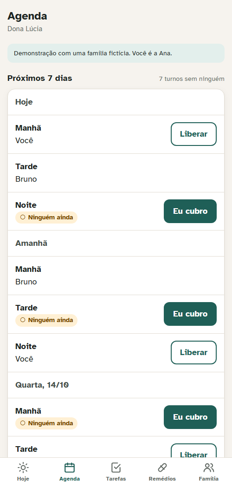
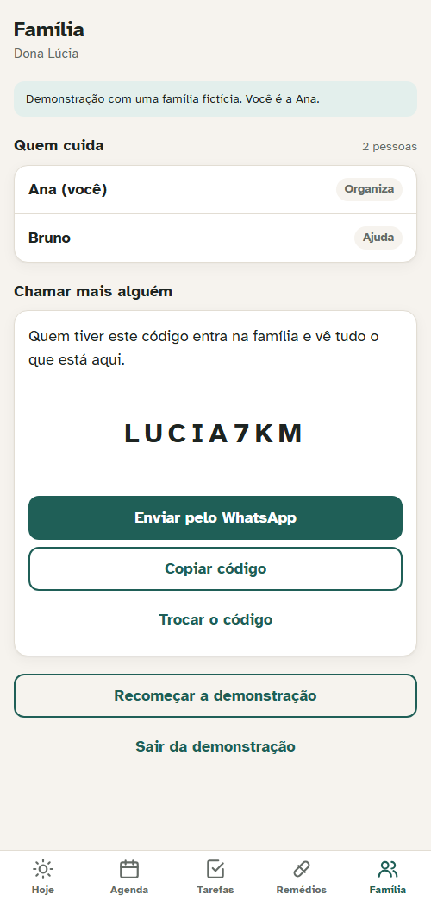

# Rede de Cuidado

A mobile web app for a family that shares the care of an older relative: who gave which medicine and
when, who covers each part of the day, and what still needs doing, in one place everyone sees.

**Try the demo:** https://bernardobonecher.github.io/rede-de-cuidado/?demo (a fictional family; no account,
runs in your browser). The interface is in Portuguese, for families in Brazil.

<p>
  
  
  
</p>

## The problem

When two or three siblings take turns caring for a parent, coordination usually lives in a WhatsApp
group. The questions that matter get buried: *did anyone give the 8 o'clock pill?*, *who's with Mom
tonight?*, *who's taking her to the cardiologist on Wednesday?* The worst failure is a medicine given
twice because two people each thought the other hadn't.

**Who it's for:** families of 2 to 6 people sharing care, many of them older and on a phone. That shaped
the interface more than any feature did.

> Hypothesis, not validated with real families: a shared, glanceable "today" view prevents missed and
> double doses better than a chat thread. This is a portfolio project; no user research was done.

## What it does

| Screen | |
|---|---|
| **Hoje** (today) | The day's doses in time order, each *upcoming*, *now*, *late* or *given by whom at what time*; who is on each shift today; the next tasks |
| **Agenda** | The next 7 days by morning, afternoon and night. Empty slots are marked; one tap to cover one, one tap to release yours |
| **Tarefas** (tasks) | One-off tasks with an optional time and person, done/undone by anyone in the family |
| **Remédios** (medicines) | Add, edit or stop a medicine with its dose, times and notes; stopping keeps the history |
| **Família** (family) | Members and an invite code to share on WhatsApp; the organizer can change the code |

Changes made by one person appear on everyone else's phone without reloading.

## Decisions

**The double dose is prevented by the database, not by the screen.** A dose is a row keyed by
(medicine, day, time) with a unique constraint. If two people tap "Dei" at the same moment, the second
gets a conflict, and the app says *"Bruno already gave this dose at 08:04. Don't give it again."* The
same pattern guards shifts: you can only take a slot that is still free.

**Security lives in Postgres.** Every table has Row Level Security: you only see and change rows of the
family you belong to. Families are created and joined only through two database functions, so nobody
can add themselves to a family without its code. A member can't promote themselves to organizer
(only `display_name` is updatable at the column level). The rules are tested against the real project,
as real users, through the same API the app uses ([supabase/tests/rls.test.mjs](supabase/tests/rls.test.mjs), 14 tests).

**Built for older eyes and hands.** 18 px base text in
[Atkinson Hyperlegible](https://www.brailleinstitute.org/freefont/), a typeface designed for low vision;
48 px minimum touch targets; status always in words plus a symbol, never color alone; light and dark
themes; labeled controls and a live region for confirmations, so a screen reader announces what happened.

**Undo instead of "are you sure?".** Marking a dose shows a confirmation with *Desfazer* (undo) for a
few seconds. A confirmation dialog on every tap would slow down the most frequent action.

**Closed sign-ups, open demo.** This is a health-adjacent app on a personal project. Letting the public
create accounts would mean storing real families' medication data. So the backend only has test accounts,
and the public demo runs entirely in the browser with a fictional family. The demo store follows the
same rules as the database (tested in [src/data/demo.test.ts](src/data/demo.test.ts)), so it behaves the
same way. A simulated relative marks a dose about 25 seconds in, to show live updates.

**Demo visitors don't download the backend client.** The Supabase client is loaded only after "Entrar"
(sign in): 80 KB gzipped for the demo, plus 60 KB when signing in.

## Architecture

```
React screens ──► Store interface ──┬─► LiveStore ──► Supabase: Auth · Postgres + RLS · Realtime
                                    └─► DemoStore ──► memory + localStorage (fictional family)
domain.ts: dose schedule, statuses, shift grid, task order, input validation (pure functions)
```

- `supabase/migrations/` — schema, RLS policies and functions, in the order applied. Includes the
  follow-ups from the Supabase security and performance advisors (private schema for policy helpers,
  indexes on composite foreign keys) and proper HTTP statuses from the functions (a wrong invite code
  is a 404, not a 500).
- `src/domain.ts` — the rules, with no React or Supabase in it.
- `src/data/` — the `Store` interface and its two implementations.
- `src/ui/` — screens and the `useCircle` hook (loading, realtime, clock, offline, conflict messages).

## Tests

```bash
npm test             # 21 tests: domain rules, demo store rules, screen behavior (Vitest + Testing Library)
npm run test:rls     # 14 tests: Row Level Security against the live project, as real test users
```

The RLS suite needs the test accounts in `.env.local`, which is not in the repository. CI runs type
checks, unit and screen tests, and the build on every push.

Also checked by hand in the browser: the demo end to end, signing in as a test user, a second user's
dose and undo reaching the first user's screen live, and every screen at 360 px wide with no
horizontal scroll.

## Run it

```bash
npm install
npm run dev          # http://localhost:5173/rede-de-cuidado/  (add ?demo to skip the start screen)
npm run build
```

The live mode points at this project's Supabase instance. To run your own: create a project, apply
`supabase/migrations/*.sql` in order, replace the URL and publishable key in `src/data/live.ts` and
`scripts/rest.mjs`, and create users in the Supabase dashboard.

## Limitations

- No notifications or reminders yet. That is the obvious next step and needs a push service.
- No offline writes: without internet the app shows the last data and blocks changes, instead of
  queueing them and risking a double dose on sync.
- One family per account in the interface (the database supports more).
- Not a medical device. It records what people did; it doesn't check doses or interactions.

Built with Claude Code. Code under the [MIT License](LICENSE).
